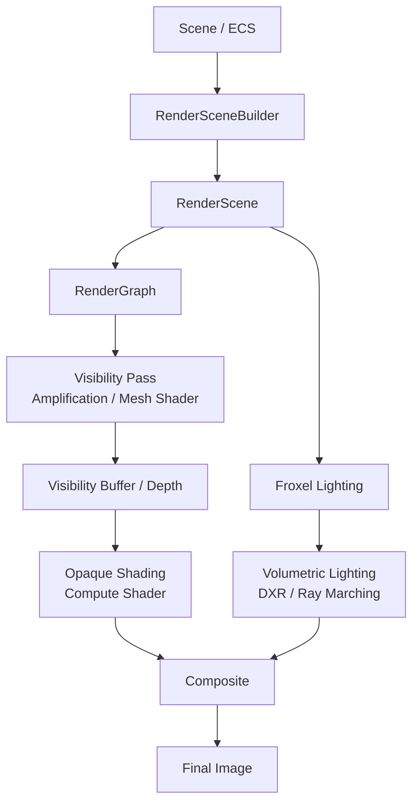

# AlphaEngine

**C++23 / DirectX 12 で個人開発しているゲームエンジン**

AlphaEngine は、ゲームの描画処理だけでなく、その土台となるリソース管理やアセット管理、シーンとの連携まで、自分で設計・実装することを目的としたプロジェクトです。

現在は **GPU-Driven Rendering、Visibility Buffer、DXR、Volumetric Lighting** を中心に開発しています。商用製品や完成済みの汎用エンジンではなく、技術の調査・実装・検証を進めている開発途中のエンジンです。

- **開発開始**：2026年2月28日
- **言語**：C++23 / HLSL
- **グラフィックス API**：DirectX 12（Mesh Shader / DXR）
- **対象環境**：Windows
- **技術解説**：[Zenn — ゲームエンジン : AlphaEngine](https://zenn.dev/reu/articles/d3f0378825fb45)

> 画像は描画テスト用のシーンです。シーン内の外部アセットはエンジン本体の成果物とは区別しています。

## 主な実装機能

| 分野 | 実装内容 |
| --- | --- |
| レンダリング | Amplification Shader / Mesh Shader、GPU-Driven Rendering、Bindless リソース参照 |
| 描画パイプライン | Visibility Buffer の生成と、後段の Compute Shader によるシェーディング |
| レイトレーシング | DXR、BLAS / TLAS の構築・更新、シャドウ処理など |
| ライティング | Froxel を利用した光源情報の格納、Ray Marching による Volumetric Lighting |
| パーティクル | Compute Shader による更新と Mesh Shader による描画を行う GPU Particle System |
| アニメーション | Animation State Machine / Graph、Animation Blend、GPU Skinning、FABRIK による IK |
| アセット管理 | AssetManager / AssetHandle、モデル・テクスチャの読み込み、GPU リソースとの分離 |
| シーン管理 | EnTT を用いた ECS、RenderScene / RenderSceneBuilder |
| 描画管理・デバッグ | 簡易 RenderGraph、各種リソース・Descriptor 管理、ImGui による GPU プロファイラ |

### レンダリングパイプライン

エンジンのシーン情報を GPU 描画用のデータに変換し、レンダラーが ECS に直接依存しない構成にしています。

- **RenderSceneBuilder**：ECS の各種 Component から、描画に必要な Instance / Light / Volume などを収集・変換します。
- **GPU-Driven Rendering**：Meshlet 単位で描画処理を構成し、Bindless な GPU リソース参照を利用します。
- **Visibility Buffer**：Geometry Pass では主に可視情報を記録し、その後のシェーディング処理でマテリアル・頂点情報を復元します。
- **Volumetric Lighting**：Froxel に格納した光源情報と Ray Marching を用い、散乱光と透過率を計算してシーンへ合成します。

※ 現在の RenderGraph は Pass とリソースの管理が主目的の簡易実装です。依存関係に基づく Pass 順序の自動解決は未実装です。

### 描画例

| Visibility Buffer の可視化 | Volumetric Lighting |
| :---: | :---: |
|  |  |

### GPU Particle System

Emitter はパーティクルの生成を担当し、生成後の粒子は Emitter から独立して GPU 上で更新されます。更新には Compute Shader、描画には Mesh Shader を使用しています。

### Asset / Animation System

Asset は `AssetHandle` を介して管理し、CPU 側の Asset 管理と GPU 側の Render Resource 管理を分離しています。また、Animation State Machine / Graph による状態遷移、ブレンド、GPU Skinning、FABRIK による IK を実装しています。

## 開発状況・既知の課題

このプロジェクトは**現在も開発中**です。以下は実装済みの機能ではなく、今後取り組む項目です。

- **Clustered Lighting の導入**（未実装。ライティング最適化の一環として検討中）
- Frustum / Occlusion Culling など、カリング処理の本格的な最適化
- Opaque Shading、Volumetric Lighting、Acceleration Structure 構築などの負荷分析・改善
- RenderGraph の依存解決・実行順序管理の拡張
- Physics System、Audio System / AHI
- マルチスレッド化 / Job System
- エディター機能の拡充

**Clustered Lighting は現時点で実装していません。** Volumetric Lighting 用の Froxel 処理とは別に、今後のライティング最適化として検討しています。

## パフォーマンス（参考値）

Zenn に掲載したテストシーンでは、下記の条件で **GPU Frame 約11〜13 ms** を確認しています。

| 項目 | 条件 |
| --- | --- |
| 解像度 | 1920 × 1080 |
| GPU | NVIDIA GeForce RTX 3070 |
| CPU | AMD Ryzen 9 5900X |
| 光源数 | 107 灯 |
| 計測時期 | 2026年10月の記事掲載時点 |

最適化途中の特定シーンにおける参考値であり、すべての環境やシーンでの性能を保証するものではありません。

## 開発環境・使用ライブラリ

- **OS / IDE**：Windows / Visual Studio
- **言語**：C++23、HLSL
- **Graphics API**：DirectX 12（Mesh Shader、DXR）
- **主要ライブラリ**：[EnTT](https://github.com/skypjack/entt)、[Dear ImGui](https://github.com/ocornut/imgui)、[meshoptimizer](https://github.com/zeux/meshoptimizer)、[ufbx](https://github.com/ufbx/ufbx)、[tinyddsloader](https://github.com/benikabocha/tinyddsloader)、[stb](https://github.com/nothings/stb)

## ビルド・実行について

Windows / Visual Studio 環境で開発しています。実行には DirectX 12 に対応し、使用する **Mesh Shader / DXR 機能**をサポートする GPU・ドライバーが必要です。

1. サンプルモデルのダウンロード

現在のデモシーンでは、NVIDIAが公開している Amazon Lumberyard Bistro を使用しています。

以下のページからモデルをダウンロードしてください。

https://developer.nvidia.com/orca/amazon-lumberyard-bistro

2. モデルの配置

ダウンロードしたBistroのデータを展開し、以下のディレクトリに配置してください。

AlphaEngine/
└──Asset/
	└──Model/
		└──Bistro_v5_2/
				├── BistroExterior.fbx
				├── BistroInterior.fbx
				├── Textures/
				└── ...

Bistro_v5_2 フォルダの直下に BistroExterior.fbx が存在するようにしてください。

※ Bistroのモデルデータは本リポジトリには含まれていません。

3. ビルド・実行

Visual Studioでプロジェクトを開き、ビルドして実行してください。

現在のデモでは、Bistroの屋外シーンを読み込んで描画します。

## 技術記事

- [AlphaEngine の概要・構成・描画結果](https://zenn.dev/reu/articles/d3f0378825fb45)
- [レンダリングデータフロー](https://zenn.dev/reu/articles/95a3177542d5d5)
- [GPU Particle System](https://zenn.dev/reu/articles/2a535a8eb94dc1)
- [Asset System](https://zenn.dev/reu/articles/7b19c53305f7be)

## 補足

- 本リポジトリは個人による学習・研究・ポートフォリオを目的とした開発プロジェクトです。
- 掲載画像には検証用の外部 3D アセットなどが含まれる場合があります。それらの権利は各権利者に帰属します。
- ソースコードの利用条件については、リポジトリ公開時に `LICENSE` の有無と各依存ライブラリのライセンスを確認してください。

## Third-Party Assets

### Amazon Lumberyard Bistro

The Bistro scene is used for rendering and lighting tests.

- Original Author: Amazon Lumberyard
- Source: https://developer.nvidia.com/orca/amazon-lumberyard-bistro
- License: [CC BY 4.0](https://creativecommons.org/licenses/by/4.0/)
- Modifications: No modifications to the original assets.

The scene is used to demonstrate AlphaEngine's rendering
capabilities. AlphaEngine is an independent project and
is not affiliated with Amazon or NVIDIA.